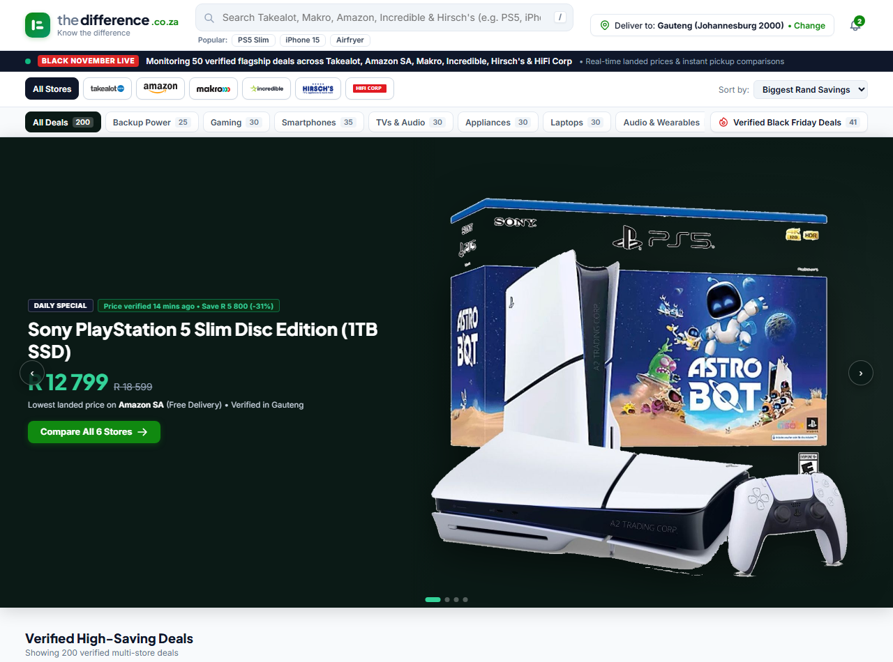
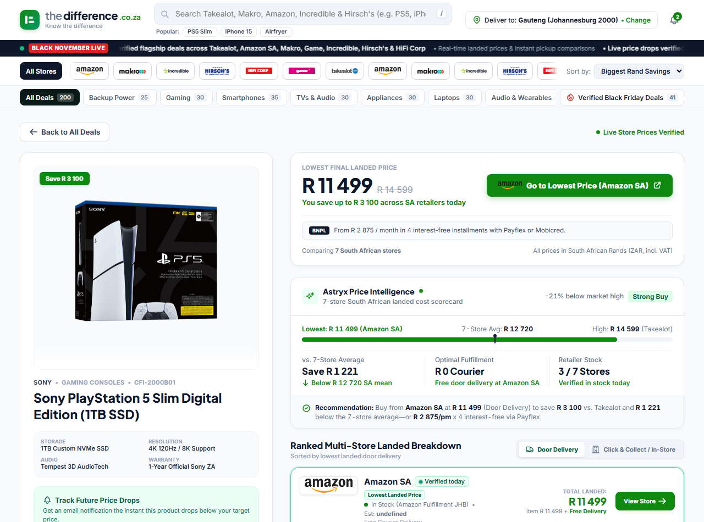
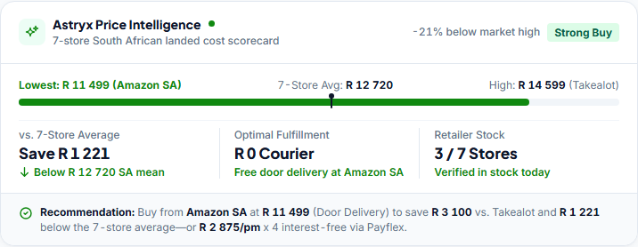
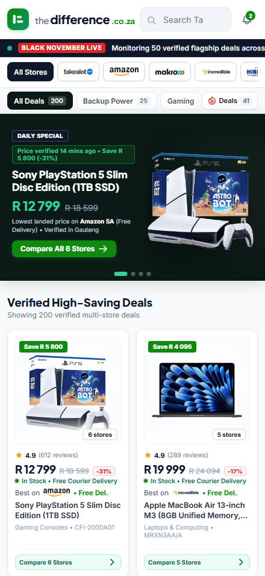
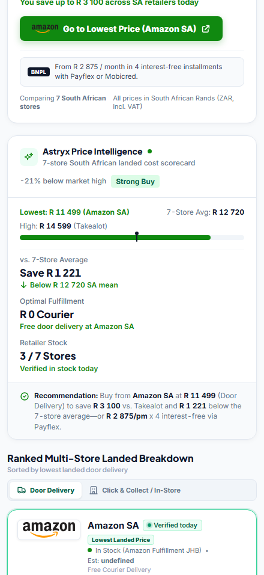
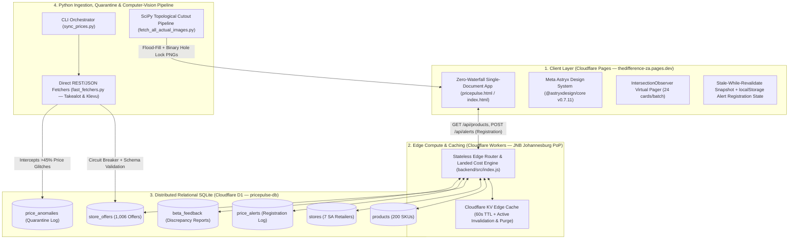

<div align="center">

# The Difference (`thedifference.co.za`)
### South Africa's Real-Time Landed Cost & Retail Intelligence Engine

[](https://thedifference-za.pages.dev/)
[-Cloudflare_Workers_%2B_D1-f38020?style=for-the-badge&logo=cloudflare&logoColor=white)](https://pricepulse-backend.pricepulse-sa.workers.dev/api/health)
[](https://github.com/meta/astryx)
[](TEST_RESULTS.md)

**Comparing 200 flagship products and 1,006 verified offers across 7 South African retailers:**  
**Takealot** • **Amazon SA** • **Makro SA** • **Game** • **Incredible Connection** • **Hirsch's** • **HiFi Corp**  
*(Note: Catalog data includes 1,006 committed offers across 7 retailers. The ingestion pipeline in `backend/scrapers/` currently supports 6 active scrapers — Takealot, Amazon SA, Makro SA, Incredible Connection, Hirsch's, and HiFi Corp — while the scraper for Game is pending. Automated refresh scheduling and production synchronization for the ingestion pipeline remain to be completed and verified in production.)*

[**Launch Live App →**](https://thedifference-za.pages.dev/) &nbsp;|&nbsp; [**Inspect Live Edge API (`/api/products`) →**](https://pricepulse-backend.pricepulse-sa.workers.dev/api/products) &nbsp;|&nbsp; [**Edge Health Check (`/api/health`) →**](https://pricepulse-backend.pricepulse-sa.workers.dev/api/health) &nbsp;|&nbsp; [**View Test Results (108/108) →**](TEST_RESULTS.md)

</div>

---

## Visual Showcase

### 1. Full-Screen Catalog, Live Moving Ticker & Hero Stage (`1280×950` Desktop)


### 2. Multi-Retailer Landed Comparison & Meta Astryx Price Intelligence (`1280×950` Desktop)


### 3. Meta Astryx Price Intelligence Scorecard (`@astryxdesign/core` v0.7.11)


### 4. Mobile-First Responsive Experience (`440×956` iPhone 16 Viewport — Zero Horizontal Overflow)
| Mobile Catalog & Hero Stage | Mobile Comparison & Astryx Scorecard |
| :---: | :---: |
|  |  |

---

## Why This Project Exists (The Engineering & Consumer Problem)

In South African e-commerce, **the advertised shelf price is rarely what a shopper pays at checkout**. Retailers enforce varying courier surcharges (R70–R150), conditional free-shipping thresholds (e.g., R650 at Takealot, R500 at Amazon SA), and different policies for in-store collection or Pargo pickup points. Furthermore, out-of-stock or stale "phantom specials" frequently distort traditional price aggregators.

**The Difference** solves this end-to-end by computing **deterministic landed prices** in real time:
1. **Deterministic Landed Cost Calculation**: Evaluates `totalLanded = itemPrice + storedDeliveryFee` for **Door Delivery** based on stored retailer offer delivery fees, and dynamically sets the delivery component to zero (`totalLanded = itemPrice + 0`) and re-ranks available offers when the user toggles **Click & Collect / In-Store Collection**. Landed costs are computed directly from stored offer delivery data rather than dynamically evaluating live retailer courier shipping policies at runtime.
2. **Source-of-Truth Champion Policy**: Disqualifies out-of-stock or stale (>24h) offers from claiming the `#1 Lowest Landed Price` badge—only verified, in-stock inventory can win the primary buy CTA.
3. **Astryx Price Intelligence Scorecard**: Computes the **Store Average** (arithmetic mean across available retailer offers, averaging 5.03 offers per product), maximum price spread percentage, savings vs. store average, and 4-month interest-free **Payflex / Mobicred** BNPL installments (`lowestLanded / 4`).

---

## System Architecture



---

## Key Technical Highlights (For Engineering Reviewers)

| Engineering Domain | Implementation Details & Measurable Impact | Key Files |
| :--- | :--- | :--- |
| **Edge Compute & Distributed SQLite (`Cloudflare Workers` + `D1` + `KV`)** | Deployed to the Johannesburg (`JNB`) edge PoP. Executes parameterized SQL joins across 7 normalized tables (`products`, `stores`, `store_offers`, `price_history`, `price_alerts`, `price_anomalies`, `beta_feedback`) in **`< 1ms` SQL execution time**, backed by composite B-tree indexes and a 60s Cloudflare KV read-through cache with active cache invalidation and global cache purge support (`await env.CACHE.delete(key)`). | [`backend/src/index.js`](backend/src/index.js), [`backend/schema.sql`](backend/schema.sql) |
| **Meta Astryx Design System (`@astryxdesign/core` v0.7.11)** | Implements CSS Cascade Layers (`@layer reset, astryx-base, astryx-theme`), scoped media contexts (`data-astryx-media="dark"` vs. `"light"`), and the official `@astryxdesign/cli` `CardWithInnerLayout` + `dashboard-scorecard` pattern with `ProgressBar` target marks and `tabular-nums` typography. | [`pricepulse.html`](pricepulse.html), [`.agents/skills/astryx/SKILL.md`](.agents/skills/astryx/SKILL.md) |
| **Stale-While-Revalidate & Virtualized DOM Pagination** | Boots at **0ms network latency** from an embedded canonical snapshot and reconciles asynchronously with `/api/products`. Uses native `IntersectionObserver` pagination (`#catalogSentinel`) to mount 24 cards per scroll batch, maintaining 60fps across 200 products (1,006 offers). | [`pricepulse.html`](pricepulse.html) |
| **Retailer Ingestion Pipeline, Resilience & Quarantine** | Multi-tier Python data-ingestion pipeline (`backend/scrapers/`) with active fast fetchers for 6 retailers (Takealot, Amazon SA, Makro SA, Incredible Connection, Hirsch's, HiFi Corp; Game scraper pending). Uses token-overlap scoring (`is_relevant_match`) to reject accessories/cases, per-domain circuit breakers, and an anomaly quarantine gate diverting >45% price spikes to `price_anomalies`. Automated refresh scheduling and production synchronization remain to be completed and verified. | [`backend/scrapers/fast_fetchers.py`](backend/scrapers/fast_fetchers.py), [`backend/tests/test_resilience_and_quarantine.py`](backend/tests/test_resilience_and_quarantine.py) |
| **Non-Destructive Computer-Vision Packshot Pipeline (`NumPy` + `SciPy`)** | Replaces destructive brightness thresholding with topological border-connected flood fill (`scipy.ndimage.label`) + binary interior hole locking (`binary_fill_holes`) + bottom-22% gradient floor-shadow removal + edge color decontamination, preserving white product hardware (e.g., PS5 Slim faceplates). | [`backend/scrapers/fetch_all_actual_images.py`](backend/scrapers/fetch_all_actual_images.py), [`.agents/skills/product-asset-pipeline/SKILL.md`](.agents/skills/product-asset-pipeline/SKILL.md) |
| **108-Assertion Automated Verification Suite** | End-to-end test battery verifying static Zero-Emoji compliance, offline SVG brand logos, XSS/SQLi search input resilience, financial landed-cost unit tests, active KV cache deletion, price-alert registration validation, 1,006 committed catalog offers, live Cloudflare Edge health, and zero horizontal overflow across `320px`, `375px`, `440px`, and `1280px` viewports. | [`.agents/teamwork/challenger_m1_2/test_suite.py`](.agents/teamwork/challenger_m1_2/test_suite.py), [`TEST_RESULTS.md`](TEST_RESULTS.md) |

---

## Verified Test Results & Quality Audit (108/108 Passing)

All **108 automated test assertions** in the test harness ([`.agents/teamwork/challenger_m1_2/test_suite.py`](.agents/teamwork/challenger_m1_2/test_suite.py)) pass with **zero failures** (100% pass rate).

- **Execution Environment**: Microsoft Windows (Windows 11 / win32, NT 10.0.26200.0)
- **Runtimes**: Python 3.11.9 (compatible with Python 3.11+ / 3.12+), Node.js v24.18.0 (compatible with Node.js v20+ / Cloudflare Workers runtime)
- **Edge Deployment**: Cloudflare Edge (Johannesburg / JNB PoP), D1 (`pricepulse-db`), KV (`CACHE`)
- **Browser Engine**: Playwright Chromium (Headless)
- **Execution Timestamp**: 2026-11-09
- **Audit Verification Standard**: Static badges are not treated as sufficient proof of current operational readiness. Complete execution logs, execution environment specifications, deep architectural verifications (active KV cache deletion, price-alert registration validation, committed 1,006 catalog offers, and stored fee landed cost), and the comprehensive 108-assertion breakdown table are published in [**`TEST_RESULTS.md`**](TEST_RESULTS.md).

---

## Quick Start & Local Development

### 1. Run the Frontend Locally
```bash
python -m http.server 8080
# Open http://localhost:8080/pricepulse.html
```

### 2. Run the Cloudflare Worker & D1 Edge API Locally
```bash
cd backend
npm install
npx wrangler dev --port 8787
```

### 3. Run the 108-Assertion Automated Test Suite
```bash
# Runs static source checks, Python financial & quarantine unit tests,
# active KV cache deletion checks, price-alert registration validation,
# live Cloudflare Edge checks, and headless Playwright browser stress tests:
python -X utf8 .agents/teamwork/challenger_m1_2/test_suite.py
```

### 4. Query Registered Price-Drop Alerts in Cloudflare D1
```bash
# The price-alert feature operates as a user registration endpoint, storing
# user email, target price, and product ID in D1 for drop tracking.
# (Note: Automated outbound email delivery service is pending/unconfigured):
cd backend
npx wrangler d1 execute pricepulse-db --remote --command "SELECT id, user_email, product_id, target_price, status, created_at FROM price_alerts ORDER BY created_at DESC;"
```

---

## Project Structure

```text
thedifference-za/
├── index.html                                  # Production entry point (Cloudflare Pages)
├── pricepulse.html                             # Canonical single-document application & Astryx UI
├── AGENTS.md                                   # Architectural standards & anti-AI aesthetic rules
├── TEST_RESULTS.md                             # Publication-grade 108-assertion test execution report
├── TEST_READY.md                               # Automated test coverage breakdown & feature checklist
├── docs/screenshots/                           # High-resolution Desktop & Mobile UI captures
├── images/products/                            # 200 flood-fill & hole-locked transparent PNG packshots
├── backend/
│   ├── src/index.js                            # Cloudflare Worker API router, D1 queries & KV cache
│   ├── schema.sql                              # 7-table Cloudflare D1 relational schema & indexes
│   ├── wrangler.toml                           # Cloudflare Worker, D1 & KV binding configuration
│   ├── scrapers/
│   │   ├── sync_prices.py                      # Multi-tier CLI scraper orchestrator (--category, --tier)
│   │   ├── fast_fetchers.py                    # Direct REST/JSON fetchers & relevance scoring
│   │   └── fetch_all_actual_images.py          # SciPy/NumPy computer-vision packshot cutout pipeline
│   └── tests/
│       ├── test_financial_calculations.py      # Landed cost, BNPL & champion selection unit tests
│       └── test_resilience_and_quarantine.py   # Circuit breaker, schema & anomaly quarantine unit tests
└── .agents/
    ├── skills/                                 # Reusable agent skills (astryx, asset-pipeline, QA)
    └── teamwork/challenger_m1_2/test_suite.py  # 108-assertion Playwright + Edge verification suite
```

---

## Author

**Reamogetswe Molefe**  
- GitHub: [@reamogetswemolefe0190-cmd](https://github.com/reamogetswemolefe0190-cmd)
- Live Application: [https://thedifference-za.pages.dev/](https://thedifference-za.pages.dev/)
